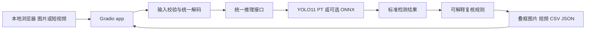

# 当前技术栈与建议的运行结构

## 原项目实际用了什么

| 类别 | 实查内容 | 意义 |
| --- | --- | --- |
| 语言 | Python；Markdown、YAML | 主逻辑是 Python 脚本，不是完整网页应用 |
| 模型框架 | Ultralytics YOLO11n / YOLO11s，底层 PyTorch | 迁移学习训练、检测与验证 |
| 加速 | CUDA 调用、固定 GPU 设备号 | 原脚本明显偏向 NVIDIA Windows 环境 |
| 图像视频 | OpenCV、Pillow、NumPy | 读取、扰动、叠框、视频编码 |
| 数据处理 | pandas、XML 标准库等 | 标注解析、CSV 清单和统计 |
| 图表 | matplotlib | EDA 和实验图 |
| 报告 | ReportLab、pypdf、python-pptx | 生成 PDF 和 PPT，当前共享依赖遗漏部分库 |
| 输入标注 | Pascal VOC XML 转 YOLO TXT | 需固定类别及坐标转换规则 |
| UI/服务 | 未找到 Gradio、Streamlit、FastAPI、Flask 或前端项目 | 当前 Demo 是离线处理脚本，网页能力需要补做 |
| 部署 | 未找到 Dockerfile、Mac 启动器、Windows 启动器、ONNX 产物 | 跨平台部署目前不能算完成 |

原包锁定 `torch==2.14.1+cu130`、`torchvision==0.29.1+cu130`、`torchaudio==2.11.0+cu130`；这只是材料记录，尚未验证这些条目在目标环境中的来源、版本配对与安装可行性。两份权重静态元数据均记录 Ultralytics 8.4.177。Python 的原训练版本没有足够证据，当前电脑可见 Python 3.11 也不能反证原训练版本。

先尝试恢复原训练环境的版本、安装源、日志和 wheel 信息；无法恢复时，选官方支持且能通过测试的一组环境，建立新的复现版本。不能凭网络文档某个版本页存在，就断言原 requirements 可以完整安装。PyTorch 安装配对按[官方版本页面](https://pytorch.org/get-started/previous-versions/)和实际平台验证。

## 建议增加的部分

推荐 **Gradio 网页界面 + 单一 Python 推理核心**。组员打开浏览器即可操作，本地运行仍在各自电脑上完成。不需要为这个课程项目增加 React、独立数据库和多个微服务。



Gradio 作为展示框架的使用方式可参见 [Hugging Face 的 Gradio Spaces 官方说明](https://huggingface.co/docs/hub/spaces-sdks-gradio)。本地架构是本项目建议，尚未实现或在你们机器上验证。

## 运行职责

| 环境 | 必做用途 | 建议设备策略 |
| --- | --- | --- |
| 训练环境 | 数据准备、主要训练、完整评估、展示 | NVIDIA 可用时 cuda；明确提供 cpu 分支 |
| 其他 Windows 演示环境 | 复演与协作，可选训练 | cpu 或经检测的 cuda |
| Mac 演示环境 | 图片/短视频展示、导出、验收；无需重训 | 先 cpu，Apple Silicon 的 mps 单独测试后启用 |
| 可选云 GPU | 多随机种子或高分辨率训练超出本机预算时使用 | 沿用冻结清单与协议，记录不同硬件 |
| 可选远程网页 | 外部人员无需安装即可试用 | 服务端推理，与 Mac 本机运行分开记录 |

Apple 的加速后端是 MPS，不能安装 CUDA 构建来获得 Mac GPU 加速；是否支持需运行时检测。参考 [PyTorch MPS 官方说明](https://docs.pytorch.org/docs/2.14/notes/mps.html)。Intel Mac 与 Apple Silicon 分开记录；若目标 Intel Mac 找不到合适的 PyTorch wheel，才评估已验证版本或 ONNX Runtime 路线，不能预先保证所有 Mac 都兼容。

## 建议的仓库目录

以下是后续实施目标，不表示这些新模块本次已创建。

```text
road-damage/
  README.md
  docs/                    # 本规划、阶段文档、状态、决策
  src/road_damage/
    inference.py           # 唯一推理入口
    priority.py            # 纯规则，不在导入时加载模型
    media.py               # 图片和视频输入输出
  app/app.py               # Gradio，调用同一 inference
  scripts/                 # 数据、训练、评估、计时入口
  configs/                 # 类别、数据根、训练、阈值
  requirements/            # 公共依赖、各平台锁定、训练/报告附加依赖
  data/manifests/          # 使用相对路径的版本化清单
  models/model_card.json   # 权重哈希、数据版本、来源、精度、阈值
  models/                  # 演示权重，单独分发或受控存储
  samples/                 # 已授权的固定验收样例
  results/<experiment_id>/ # 命令、环境、逐图结果、汇总与图
  launch_windows.ps1
  launch_macos.command
  submission/              # 最终一次发布的报告、PPT、代码指引
```

相同 Python 源码不要求所有平台依赖 wheel 完全相同。共享业务依赖，分别验证 Windows CUDA 与 Mac CPU/MPS；推理不安装无用的 torchaudio，报告生成依赖放到可选组。OpenCV GUI/headless 构建选其一，避免同一环境重复安装两者。

统一推理接口建议接收 `image, model_id, device, conf, iou, imgsz`，返回 `class_id, class_name, confidence, xyxy, image_size, model_sha256, threshold_version, latency`。坐标定义为原图像素；视频附 frame_index/timestamp。类别名称从锁定映射读取，不能随不同入口重排。

## Windows 训练预算与云端选择

训练机已确认 RTX 3060 Laptop 6 GB。先完成小样本 1–3 epoch，`imgsz=640`；n 可从 batch=4、s 可从 batch=2 起试，仅作初始探测值，不保证必然适合当前环境。正式 n/s 对照优先采用两者都能容纳的相同 batch，记录显存峰值与每 epoch 时间。对完整训练集先试一个 epoch，再估算 `实测秒数 × 计划上限 × 实验数` 并留验证/重跑余量。小样本速度不能直接等比外推完整训练。

显存不足依次减 batch、避免同时跑多个模型、确认图像尺寸与缓存；不要在不同对照实验中悄悄更改多个因素。主对照建议 n/s 各一次，增强模型一次，若时间充足再补关键对照的 3 个随机种子。

只有在这些实测后仍超出可接受排期，或高分辨率实验确实需要更多显存时，云 GPU 才有明确价值。无需先买服务器，也无需以零经验的 Linux/Docker 作为项目门槛。
