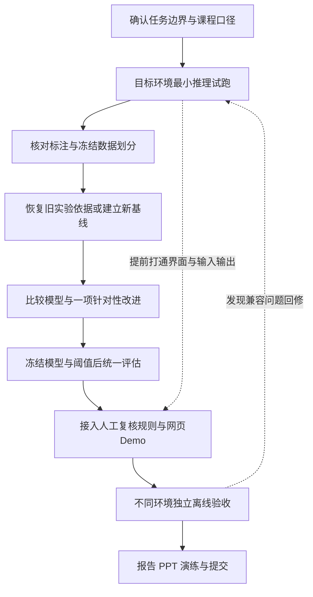

# CDS540 道路损坏检测项目执行规划

这份规划基于对你提供的初实现压缩包、选题 Word、评分摘要、包内课程原始 PDF，以及美国、印度、捷克三个数据压缩包的实际核对。当前最需要的工作是修复复现链路和实验口径，再完成不同演示环境的独立运行验收。已有模型、脚本和材料值得保留，不建议推倒重来。

版本：2026-10-15。适用于五人小组的协作讨论与执行。文中的角色均为待认领的模块分工，不对应特定成员，也不默认阅读者承担项目协调职责。设备条件只在环境配置与部署验收部分说明。

## 先看哪几份

| 要解决的问题 | 阅读入口 |
| --- | --- |
| 现在到底完成了什么，哪里有问题 | [01_现状审计.md](01_现状审计.md) |
| 题目、目标、范围和整体步骤 | [02_项目定义与总流程.md](02_项目定义与总流程.md) |
| 原项目用了什么，环境怎么统一 | [03_技术架构与环境.md](03_技术架构与环境.md) |
| 怎么训练、怎么比较、怎么证明有效 | [04_实验设计与指标.md](04_实验设计与指标.md) |
| 不同演示环境与远程网页怎么验收 | [05_跨平台部署验收.md](05_跨平台部署验收.md) |
| 五个人怎么分工，怎样对应评分 | [06_评分映射与团队排期.md](06_评分映射与团队排期.md) |
| AI 每次接手应该先读什么 | [07_AI执行约定.md](07_AI执行约定.md) |
| 官方资料和来源冲突 | [08_来源与待确认事项.md](08_来源与待确认事项.md) |
| 原项目换电脑怎么跑，交给另一位 AI 要什么 | [09_跨电脑运行问题与AI交接.md](09_跨电脑运行问题与AI交接.md) |

## 执行顺序

阶段文件放在 [stages](stages/) 目录。每阶段只有一份 Markdown，包含目标、计划、实现、验证；不要为同一阶段再拆四份重复文档。实施时按“当前阶段通过验收后进入下一阶段”推进。UI 兼容性试跑从早期开始。

## 现在就做的三个任务

1. 从原开发电脑找回 `data/manifests/*.csv`、训练日志、实际环境信息；找不回时明确标为旧版本证据缺失。
2. 由认领环境任务的成员用现有权重跑一张图，再由另一位成员在不同演示环境复演；记录依赖与输出，先证明模型能够迁移。
3. 统一四类标注统计及分组划分策略。若改了训练/验证/测试归属，就建立新数据版本并重新训练，不能沿用旧权重宣称新测试集独立。

## 这次已完成与未完成

已完成：材料与代码静态审计；全部 15,340 个 XML 的解析、类别和坐标检查；两份权重文件的哈希与静态元数据检查；19 个 Python 文件语法解析；官方资料查证；本套执行与验收文档。

未执行：安装原项目环境、加载权重推理、模型训练、复算 mAP、跨环境真机运行、网页开发、云端发布。阶段状态因此不会因为原材料打了勾就自动变成通过。本包是执行规划与审计成果，不是重新实现的应用程序。

全局进度见 [STATUS.md](STATUS.md)，重要选择见 [DECISIONS.md](DECISIONS.md)，机器可读审计证据见 [evidence](evidence/)。本规划包未复制大型原始数据与模型。
