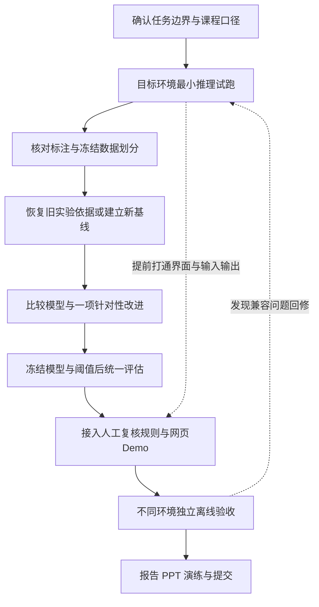

# CDS540 道路损坏检测项目执行规划

这份规划基于对你提供的初实现压缩包、选题 Word、评分摘要、包内课程原始 PDF，以及美国、印度、捷克三个数据压缩包的实际核对。当前最需要的工作是修复复现链路和实验口径，再完成不同演示环境的独立运行验收。已有模型、脚本和材料值得保留，不建议推倒重来。

版本：2026-10-16（已对照原规划并补实际运行证据）。适用于五人小组的协作讨论与执行。文中的角色均为待认领的模块分工，不对应特定成员，也不默认阅读者承担项目协调职责。设备条件只在环境配置与部署验收部分说明。

## 先看哪几份

| 要解决的问题 | 阅读入口 |
| --- | --- |
| 现在到底完成了什么，哪里有问题 | [01_现状审计.md](01_现状审计.md) |
| 题目、目标、范围和整体步骤 | [02_项目定义与总流程.md](02_项目定义与总流程.md) |
| 原项目用了什么，环境怎么统一 | [03_技术架构与环境.md](03_技术架构与环境.md) |
| 怎么训练、怎么比较、怎么证明有效 | [04_实验设计与指标.md](04_实验设计与指标.md) |
| 不同演示环境与远程网页怎么验收 | [05_跨平台部署验收.md](05_跨平台部署验收.md) |
| 五个人怎么分工，怎样对应评分 | [06_评分映射与团队排期.md](06_评分映射与团队排期.md) |
| AI 每次接手应该先读什么 | [07_AI执行约定.md](07_AI执行约定.md) |
| 官方资料和来源冲突 | [08_来源与待确认事项.md](08_来源与待确认事项.md) |
| 原项目换电脑怎么跑，交给另一位 AI 要什么 | [09_跨电脑运行问题与AI交接.md](09_跨电脑运行问题与AI交接.md) |

| 对照旧规划，查看本轮修复与剩余问题 | [10_规划对照核查与改进.md](10_规划对照核查与改进.md) |

| 全量数据、评估与阈值试验的新结果 | [11_全量复核与继续实施.md](11_全量复核与继续实施.md) |

## 执行顺序

阶段文件放在 [stages](stages/) 目录。每阶段只有一份 Markdown，包含目标、计划、实现、验证；不要为同一阶段再拆四份重复文档。实施时按“当前阶段通过验收后进入下一阶段”推进。UI 兼容性试跑从早期开始。

## 当前执行重点

原划分数据已全部转换并完成两模型全量重评；近似筛查确认相同场景跨集合，下一项为按场景组建立 data-v2 后统一预算重训。验证集阈值试验已完成，召回与误报存在明显取舍。网页、真实视频和最终稿待完成；跨电脑验收依用户要求暂缓。

当前进度见 [STATUS.md](STATUS.md)，最新结果见 [11_全量复核与继续实施.md](11_全量复核与继续实施.md)。[01](01_现状审计.md) 与 [10](10_规划对照核查与改进.md) 为此前快照；以最新状态识别后来已完成的事项。规划 ZIP 不包含运行代码、原始图片或权重。
